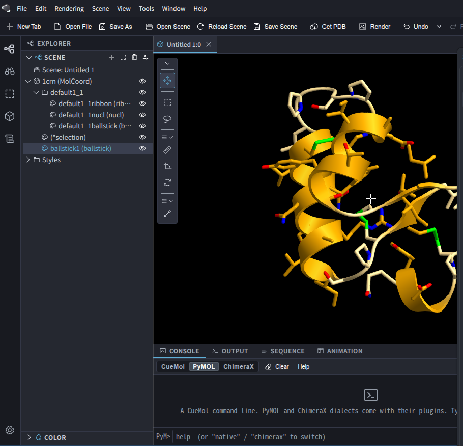

# Linux 版 CueMol3 で 3D ビューが真っ暗になる問題 (トライアル)

2026-11-09 / 対象: v3.0.0.554 (Linux x64 の AppImage と .deb)

Linux 版 CueMol3 は GUI こそ起動するものの、3D ビューが真っ暗のまま分子を描画できない。
原因は上流のビルドにあり、GitHub Releases の Linux 版全12リリース (v2.3.10.504 から
v3.0.0.554) で再現する。原因は3つある。

1. `bindPeer` が Linux では未登録 (ガードの差し戻し漏れ)
2. `share/data/shaders` が Linux パッケージに無い
3. `libcuemol2.so` の RUNPATH が macOS 形式

このフォルダには、上流向けの修正パッチ3本と、リリース済みパッケージをそのまま動かすための
ローカル回避策の実装を置いた。回避策を当てた 3.0.0.554 で、Linux 上でも分子が描画される
ことを確認している。



## 環境

- Ubuntu 22.04.4 LTS, kernel 6.8.0, X11 (`DISPLAY=:0`)
- システムの Boost は 1.74
- 同梱 Electron の Node は v24.19.0
- AppImage と .deb の `cuemol_internal.node` は md5 が一致する (中身は同一)

## エラー一覧

起動から描画まで、下の順に連鎖して発生する。前のエラーを回避すると次が現れる。

| # | 症状 | 代表的なログ | 原因 | 修正 |
| --- | --- | --- | --- | --- |
| 1 | レンダラが起動直後に異常終了 | `symbol lookup error: .../libcuemol2.so: undefined symbol: _ZN5boost10filesystem6detail15path_algorithms21find_parent_path_sizeERKNS0_4pathE` | `libcuemol2.so` の RUNPATH が `@loader_path` で、同梱 Boost 1.84 が解決されない | 0003 |
| 2 | ウィンドウは出るが 3D ビューが黒いまま | `bindCanvas failed: TypeError: this.cuemol.bindPeer is not a function` / `View::setup() setCurrent failed.` | `init_cuemol.cpp` が `bindPeer` を `__APPLE__` / `_WIN32` でしか登録しない | 0001 |
| 3 | 分子を開くとシェーダ読み込みが全滅 | `OcDisplayContext> FATAL ERROR: loadShader(gpu_line) failed!!` (`ao_composite`, `fxaa` も同様) | `share/data/shaders` が未インストール | 0002 |
| - | VS Code のターミナルから起動すると無言で即終了 (exit 0) | なし (`--no-sandbox` を渡すと `bad option`) | VS Code から `ELECTRON_RUN_AS_NODE=1` が継承され、素の Node として起動する | 利用側の環境 (ランチャーで回避) |

`Installed VAAPI version is too old` と `SharedImageManager::ProduceSkia` も出るが、
修正後も描画に影響していない。

## 原因の詳細

### 1. bindPeer が Linux で未登録 (差し戻し漏れ)

ガードの経緯は2つのコミットで説明できる。

| 日付 | コミット | 内容 |
| --- | --- | --- |
| 2026-04-29 | `5bd98514` fix(tritium/core): exclude Electron GUI C++ files on Linux | Electron GUI 用ソース (ElecView など) を `if(APPLE OR WIN32)` で除外。`init_cuemol.cpp` の include / `init_timer()` / `registerViewFactory()` / `bindPeer` 登録と、`services.hpp` の `bindPeer` 宣言を `#if defined(__APPLE__) \|\| defined(_WIN32)` で囲む |
| 2026-04-30 | `49d6298c` fix linux nodejs build | 除外を差し戻し、ソース・include・`init_timer()`・`registerViewFactory()` を全プラットフォームでビルドする形に戻す。ただし `bindPeer` の登録と宣言の2か所のガードが残った |

結果として、Linux のアドオンには `node_jsbr::bindPeer` の本体がコンパイルされ、動的
シンボル `_ZN9node_jsbr8bindPeerERKN4Napi12CallbackInfoE` として公開もされている。それでも
JS へは公開されない。出荷バイナリでも確認した。

- `process.dlopen` で列挙したエクスポートは13個で、`bindPeer` は無い (`initCueMol()` 後も同じ)
- 同梱の全 ELF を検索しても `"bindPeer\0"` リテラルが存在しない

一方、レンダラ worker の `GfxManager.bindCanvas()` はプラットフォームを問わず
`this.cuemol.bindPeer(view, this)` を呼ぶ。ここで `this.cuemol` は `core.getModule()` が
返す生のアドオンである。GfxManager がアドオンに要求するのは `getService` /
`performIdleTasks` / `bindPeer` の3つで、欠けているのは `bindPeer` だけである。
`bindCanvas` が失敗するとビューが描画ループに入らない
(`activateView: view 33 not in bound_views, skipping`)。

### 2. share/data/shaders が無い

シェーダは `%%CONFDIR%%/data/shaders/` から読む設計である。ところが Linux 版の
`resources/cuemol2/share/data/` には `shaders` が無く、パッケージ全体にも `.glsl` が1本も
含まれない。

`src/CMakeLists.txt` は、X11 の sysdep バックエンドが未移植のため、Linux では
`ENABLE_X11_SYSDEP` が OFF なら `BUILD_OPENGL_SYSDEP=FALSE` (CLI 構成) にする。
`GLSL_PREPROC` の呼び出しは sysdep / molvis / xtal の3か所すべてがこのスイッチの内側に
あるため、`src/glsl.cmake` による `share/data/shaders` への install が一切走らない。

しかし Electron 経路 (`ElecDisplayContext` から WebGL) は X11 sysdep に依存せず、同じ
シェーダを実行時に読む。「X11 sysdep をビルドしない」という判断が、tritium が必要とする
シェーダの配布まで巻き込んでいる。

### 3. libcuemol2.so の RUNPATH が macOS 形式

```
$ readelf -d resources/app/node_modules/@cuemol/core/build/lib/libcuemol2.so
 NEEDED   libboost_filesystem.so.1.84.0
 RUNPATH  @loader_path:@loader_path/../lib/python/lib:@loader_path/../Resources/python/lib
```

`@loader_path` は macOS の dyld 専用トークンで、Linux の ld.so は解釈しない。
`cuemol_internal.node` の RUNPATH は `$ORIGIN/../lib` で正しいので、`libcuemol2.so` 自体は
見つかる。しかし DT_RUNPATH は推移的に効かないため、その先の Boost 1.84 だけが解決できない。

Boost 1.84 が無いシステムでは `error while loading shared libraries` で落ちる。
`libboost_filesystem.so.1.84.0 -> ...1.74.0` のような誤ったリンクがあると、表の #1 の
`undefined symbol` になる (`path_algorithms` 名前空間は 1.74 に無い)。今回の環境は後者だった。
バイナリ群が必要とする Boost 1.84 の SONAME は9個ある (atomic, chrono, date_time,
filesystem, iostreams, program_options, system, thread, timer)。

## 影響範囲

GitHub Releases にある Linux AppImage 全12版 (v2.3.10.504 (2026-08-26) から v3.0.0.554
(2026-11-06)) を調べた。**全版で `bindPeer` 登録なし、`data/shaders` なし**だった。Linux で
3D ビューが動く公式リリースは無く、ダウングレードでは回避できない。

検証は AppImage を実行せずに行った。ELF ヘッダから squashfs のオフセットを求め、
`unsquashfs -l` で一覧を取り、`cuemol_internal.node` を抽出して `"bindPeer\0"` を検索した。
macOS / Windows 版のバイナリは未検証だが、ソース上はどちらも `bindPeer` を登録し、
`BUILD_OPENGL_SYSDEP=TRUE` でシェーダもインストールされる構成である。

## 対策方針

| 層 | 何をするか | 置き場所 |
| --- | --- | --- |
| 根本修正 (上流) | ソースとビルド設定を直す。リリースし直せば回避策は不要になる | [`upstream-patches/`](upstream-patches/) |
| 暫定回避 (利用者側) | リリース済みの .deb を展開し、欠けている登録・シェーダ・ライブラリ解決を外から補う | [`local-workaround/`](local-workaround/) |

## 上流向けパッチ (`upstream-patches/`)

develop (`a400ad56`) に対して作成した。3本とも単独でも同時でも `git apply --check` が通る。

```sh
git apply trials/261109-linux-3d-view/upstream-patches/*.patch
```

### 0001: bindPeer を Linux でも登録する

[`0001-tritium-core-register-bindPeer-on-linux.patch`](upstream-patches/0001-tritium-core-register-bindPeer-on-linux.patch)

`init_cuemol.cpp` と `services.hpp` に残った `#if defined(__APPLE__) || defined(_WIN32)`
ガードを2か所とも外す (4行削除)。差し戻し漏れの修正であり、ほかの GUI コードは既に
全プラットフォームでビルドされている。

### 0002: CLI 構成でもシェーダをインストールする

[`0002-build-install-glsl-shaders-in-cli-configuration.patch`](upstream-patches/0002-build-install-glsl-shaders-in-cli-configuration.patch)

- ogl_core のシェーダ一覧を `src/sysdep/CMakeLists.txt` から `src/sysdep/ogl_core_shaders.cmake`
  (新規、絶対パス) に切り出す。sysdep はこれを include して従来どおり処理する
- option `INSTALL_GLSL_SHADERS` (既定 ON) を追加する。sysdep をビルドしないときは、カスタム
  ターゲット `ogl_core_glsl` で同じ一覧を `GLSL_PREPROC` にかける
- molvis / xtal のシェーダ処理の条件を `BUILD_OPENGL_SYSDEP OR INSTALL_GLSL_SHADERS` にする
  (molvis の GLEW include dir は sysdep 時のみのまま分離)
- `src/glsl.cmake`: Linux では `cpp` に `-undef -ffreestanding` を足す。glibc の `cpp` は
  `stdc-predef.h` を暗黙に読み込み、`-C` によりその LGPL ライセンスコメントを全シェーダの
  先頭へ複写するうえ、`linux` / `unix` マクロも定義するため。macOS (clang) では起きないので、
  影響しないよう Linux に限定した

### 0003: libcuemol2 の install rpath を Linux では $ORIGIN にする

[`0003-build-linux-use-origin-rpath-for-libcuemol2.patch`](upstream-patches/0003-build-linux-use-origin-rpath-for-libcuemol2.patch)

`tritium/core/CMakeLists.txt` と同じ書き方で、プラットフォームごとに rpath を選ぶ。Linux は
`$ORIGIN;$ORIGIN/../lib/python/lib`、macOS は従来の値、Windows は空にする。

### パッチの検証状況

| パッチ | 確認したこと | 未確認のこと |
| --- | --- | --- |
| 0001 | `git apply --check`。ローカル回避策 (同じ関数を同じ名前で登録する) で、描画まで通ることを確認 | アドオンの再ビルド |
| 0002 | 新設の `ogl_core_glsl` 経路を、無改変の `glsl.cmake` を使う単体 CMake ハーネスでビルド・インストールした。30本が生成され、回避策の出力とバイト一致した。空ファイル、未展開の `#include`、ライセンス混入はいずれも無し | libcuemol2 全体の configure、sysdep / molvis / xtal 経路のビルド、macOS / Windows |
| 0003 | 同じ CMake 記述の単体ハーネスで、RUNPATH が `$ORIGIN:$ORIGIN/../lib/python/lib` になることを確認 | libcuemol2 の再ビルド |

上流の CI にスモークテストを足すことも提案したい。Linux パッケージに対して次の3点を検査する。

- `require('@cuemol/core').getModule().bindPeer` が関数である
- `share/data/shaders/*.glsl` が存在する
- `LD_LIBRARY_PATH` 無しで `ldd libcuemol2.so` に `not found` が無い

## ローカル回避策の実装 (`local-workaround/`)

リリース済みの .deb はそのままでは動かない。そこで中身を `~/.local/opt/CueMol3` に展開し、
足りないものを外から補う。元の .deb と AppImage は変更しない。

### 使い方

```sh
cd trials/261109-linux-3d-view/local-workaround
./apply.sh --deb /path/to/CueMol3-3.0.0.554-Linux-x64.deb --install-launcher
cuemol3            # または cuemol3 /path/to/file.pdb
```

必要なもの: `dpkg-deb`, `patch`, `g++`, `cpp`, `curl`。root 権限は不要である。

`apply.sh` は次の4段階を実行する。

1. .deb の `opt/CueMol3` を `--prefix` (既定 `~/.local/opt/CueMol3`) に展開する
2. `bindpeer_shim/build.sh` でシムをビルドし、`cuemol_internal.node` の隣に置く
3. `index.cjs.patch` を `@cuemol/core/src/index.cjs` に当てる
4. `build_shaders.sh` で `share/data/shaders` を生成する (`TAG` で版を指定、既定 v3.0.0.554)

### 構成要素

| ファイル | 役割 | 対応する上流修正 |
| --- | --- | --- |
| [`bindpeer_shim/bindpeer_shim.cpp`](local-workaround/bindpeer_shim/bindpeer_shim.cpp) | `cuemol_internal.node` にリンクして `node_jsbr::bindPeer` を解決し、`"bindPeer"` として登録するだけの N-API アドオン | 0001 |
| [`bindpeer_shim/build.sh`](local-workaround/bindpeer_shim/build.sh) | node-addon-api 8.9.2 と Node v24.19.0 のヘッダを取得してシムをビルドする | 0001 |
| [`index.cjs.patch`](local-workaround/index.cjs.patch) | `@cuemol/core` の CJS エントリで、`bindPeer` が無ければシムの関数を生のアドオンに接ぎ木する | 0001 |
| [`build_shaders.sh`](local-workaround/build_shaders.sh) | `src/glsl.cmake` と同じ `cpp` 手順を手で再現し、タグのソースから46本を生成する | 0002 |
| [`cuemol3`](local-workaround/cuemol3) | `LD_LIBRARY_PATH` を同梱 Boost に向け、`ELECTRON_RUN_AS_NODE` を外して `--no-sandbox` で起動するランチャー | 0003 |
| [`fix-boost-symlinks.sh`](local-workaround/fix-boost-symlinks.sh) | 任意。AppImage を直接起動したい場合だけ、Boost 1.84 の9個を `/lib/x86_64-linux-gnu` にリンクする (要 sudo、`--remove` で撤去) | 0003 |
| [`apply.sh`](local-workaround/apply.sh) | 上記をまとめて適用する | - |

### シムが安全に動く理由

`bindpeer_shim.cpp` の冒頭コメントに詳しく書いた。要点は次の4つ。

- **シンボル解決**: Itanium ABI は自由関数の戻り値型をマングルしない。そのため `void` で宣言しても
  同じシンボルに結び付く。実際の戻り値は `Napi::Value` (16 バイトの trivially copyable 構造体)
  で、SysV AMD64 では呼び出し側が rax/rdx を読まないだけなので無視して安全である。JS 側も
  戻り値を使っていない
- **CallbackInfo のレイアウト**: 自前の `Napi::CallbackInfo` を渡すため、node-addon-api 8.x の
  レイアウトと一致することを出荷バイナリの逆アセンブルで確かめた。`_argc` が +0x20、`_argv`
  が +0x28 で、`bindPeer` 冒頭の `cmpq $0x2,0x20(%rbx)` が引数個数チェックにあたる
- **例外**: 出荷アドオンは `_ZTIN4Napi5ErrorE` を持ち `__cxa_throw` を import しているので、
  `NAPI_CPP_EXCEPTIONS` でビルドして例外の扱いを揃えた
- **同一インスタンス**: シムの RUNPATH は `$ORIGIN` で、`cuemol_internal.node` の隣に置く。
  ld.so は Node がロード済みのオブジェクト (同一 inode) を再利用するので、グローバル状態を共有する

### 回避策の検証結果

- `apply.sh` を .deb から一から実行した結果は、手作業で組んで動作確認したツリーと
  `diff -r` で完全一致した (シムのバイナリを含む)
- 起動ログは `bindPeer called` → `pScObj: ElecView` となり、表のエラー 1 から 3 は出なくなった
- 1crn.pdb を開くと `BallStickRenderer> rendered 189 atoms, 202 bonds (coord texture)` となり、
  リボンとボールスティックが描画された (冒頭の画像)
- リポジトリの検証マーカー (`shader program created OK` など) は `console.log` 出力のため、
  production ビルドのログには出ない。代わりに上記の描画で確認した

## 未確認事項と注意

- 確認した描画はリボンとボールスティックのみである。Linux の libcuemol2 は CLI 構成
  (`USE_OPENGL` 未定義) でビルドされるので、`USE_OPENGL` 前提のコードパスは Linux では無効の
  可能性がある。ほかの描画モード、マップ表示 (xtal)、画像出力は未確認
- 上流パッチは単体ハーネスと `git apply --check` までで、libcuemol2 と tritium のフルビルドは
  していない
- `ELECTRON_RUN_AS_NODE=1` は VS Code の拡張ホスト由来で、CueMol の不具合ではない。症状が
  「無言で exit 0」なので、問い合わせ対応では最初に疑うべき項目である
- 本件に該当する issue は [CueMol/cuemol3](https://github.com/CueMol/cuemol3/issues) に
  見当たらなかった (2026-11-09 時点)

## ファイル構成

```
trials/261109-linux-3d-view/
├── README.md                      このノート
├── images/1crn-rendered-linux.png 回避策適用後の描画
├── upstream-patches/              上流向け修正 (git apply 形式)
│   ├── 0001-tritium-core-register-bindPeer-on-linux.patch
│   ├── 0002-build-install-glsl-shaders-in-cli-configuration.patch
│   └── 0003-build-linux-use-origin-rpath-for-libcuemol2.patch
└── local-workaround/              リリース済みパッケージ用の回避策
    ├── apply.sh
    ├── cuemol3
    ├── index.cjs.patch
    ├── build_shaders.sh
    ├── fix-boost-symlinks.sh
    └── bindpeer_shim/
        ├── bindpeer_shim.cpp
        └── build.sh
```
